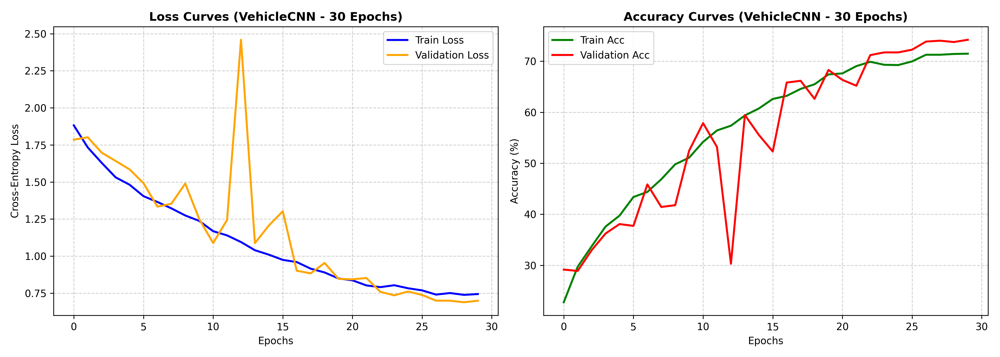
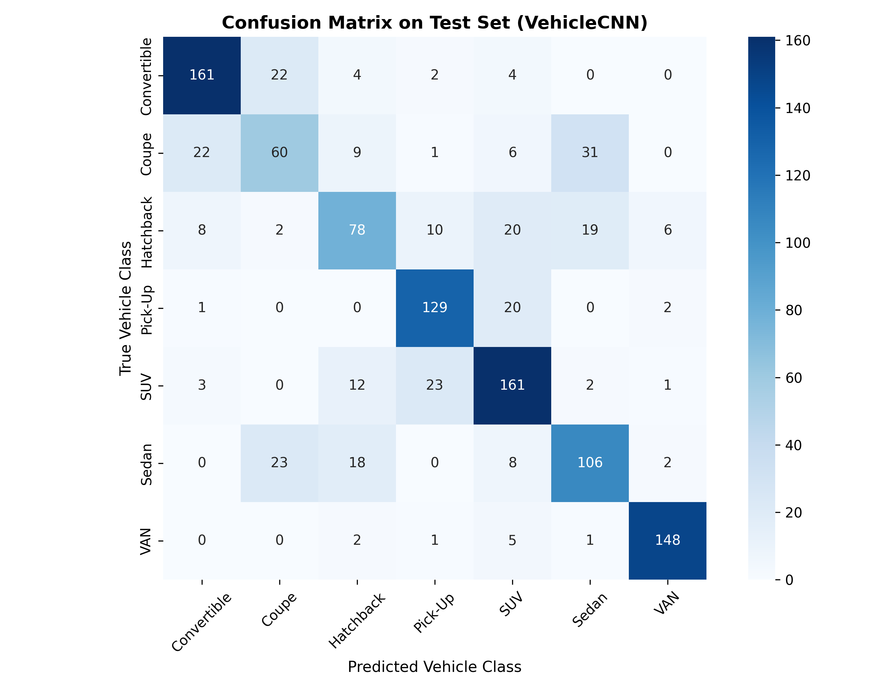
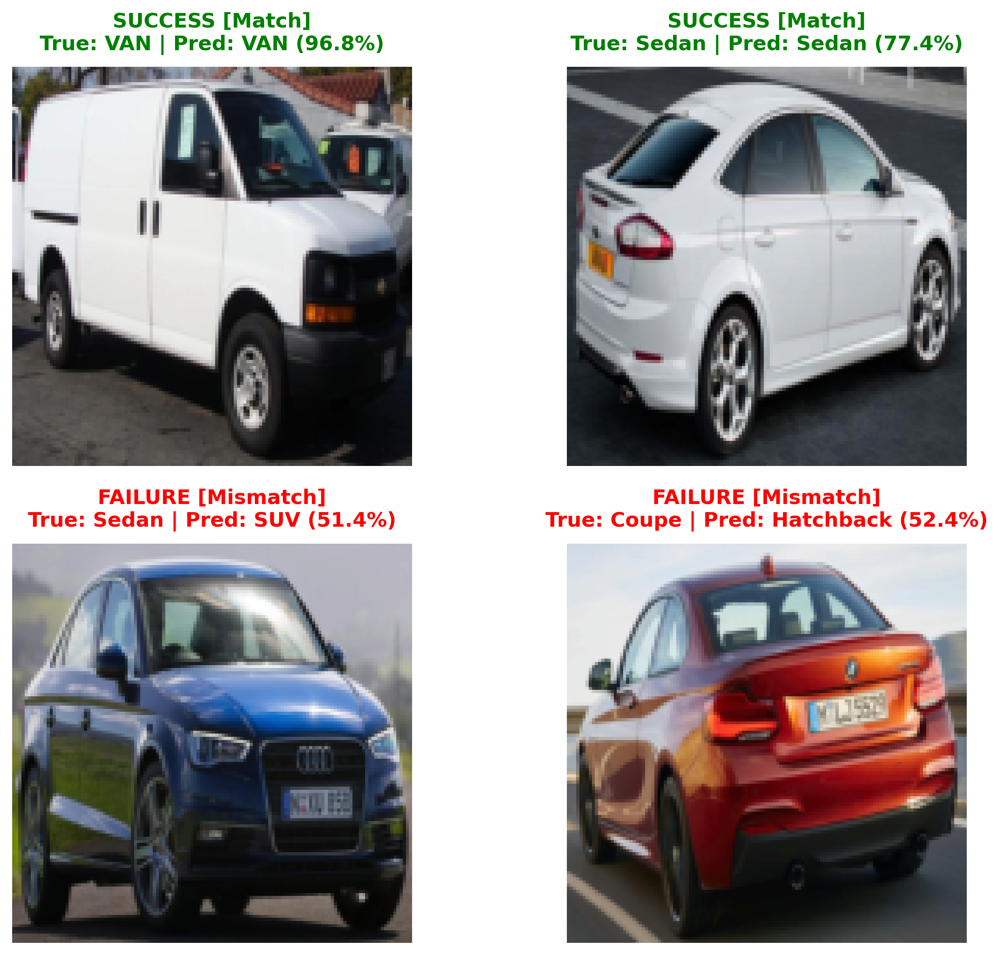

# Vehicle Body Type Classification using Custom CNN in PyTorch

An end-to-end Computer Vision project implementing a deep Convolutional Neural Network (CNN) from scratch in PyTorch to classify passenger vehicles into 7 body types. The model was trained and evaluated against a single-layer Linear baseline under strict leakage-free data partitioning.

---

## 1. Problem Overview & Dataset

* **Objective:** Classify vehicle images into 7 distinct body types: `Convertible`, `Coupe`, `Hatchback`, `Pick-Up`, `SUV`, `Sedan`, and `VAN`.
* **Dataset:** [Cars Body Type Cropped Dataset](https://www.kaggle.com/datasets/ademboukhris/cars-body-type-cropped) containing 7,549 cropped vehicle images.
* **Data Partitioning (Seed 101):**
  * **Train Set:** 5,284 images (70.0%)
  * **Validation Set:** 1,132 images (15.0%)
  * **Test Set:** 1,133 images (15.0%)
* **Data Augmentation (Train only):** `RandomHorizontalFlip(p=0.5)`, `RandomRotation(degrees=10)`, and `ColorJitter(brightness=0.2, contrast=0.2)` resized to 128x128 pixels.

---

## 2. Model Architectures

### Baseline Model (Linear Classifier)
* **Architecture:** Flatten -> Linear(3 * 128 * 128, 7)
* **Trainable Parameters:** 344,071

### Proposed Model (Custom VehicleCNN)
* **Feature Extractor:** 4 Convolutional blocks (Conv2d 3x3 + BatchNorm2d + ReLU + MaxPool2d 2x2) scaling channels: `3 -> 32 -> 64 -> 128 -> 256`
* **Classifier Head:** Global Adaptive Average Pooling (`AdaptiveAvgPool2d(1, 1)`) + Dropout(0.3) + Linear(256, 128) + ReLU + Dropout(0.2) + Linear(128, 7)
* **Trainable Parameters:** 423,175
* **Optimization:** AdamW optimizer (`lr=1e-3`, `weight_decay=1e-4`), Cosine Annealing learning rate scheduler (`T_max=30`), Cross-Entropy Loss, 30 epochs with best validation loss checkpointing.

---

## 3. Quantitative Results

Evaluation performed on the held-out test set (1,133 samples):

| Model Architecture | Parameters | Test Accuracy (%) | Macro-F1 Score |
| :--- | :---: | :---: | :---: |
| Baseline (Linear Model) | 344,071 | 37.16% | 0.3613 |
| **Custom VehicleCNN (Proposed)** | **423,175** | **74.40%** | **0.7285** |
| **Net Improvement** | **+79,104** | **+37.25%** | **+0.3672** |

### Per-Class Performance Summary (VehicleCNN)
* **Top Performing Class:** `VAN` (Precision: 93.08%, Recall: 94.27%, F1: 0.9367) due to distinct boxy silhouette.
* **Challenging Classes:** `Coupe` (F1: 0.5085) and `Hatchback` (F1: 0.5865) due to subtle rear-pillar and roofline slope variations overlapping with `Sedan` and `SUV`.

---

## 4. Visualizations & Qualitative Inspection

### Learning Curves & Confusion Matrix



### Qualitative Success vs. Failure Inspection


---

## 5. How to Run

### 1. Clone Repository
```bash
git clone https://github.com/userxx004/car-body-type-classification.git
cd car-body-type-classification
```

### 2. Install Dependencies
```bash
pip install torch torchvision kagglehub scikit-learn seaborn matplotlib
```

### 3. Run Experiments
Open and execute the notebook in Google Colab (with T4 GPU runtime enabled):
* Notebook path: `car_body_type_classification.ipynb`
